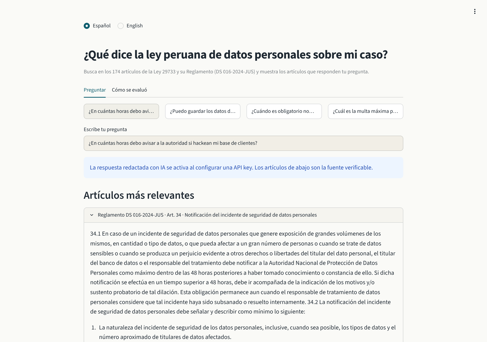
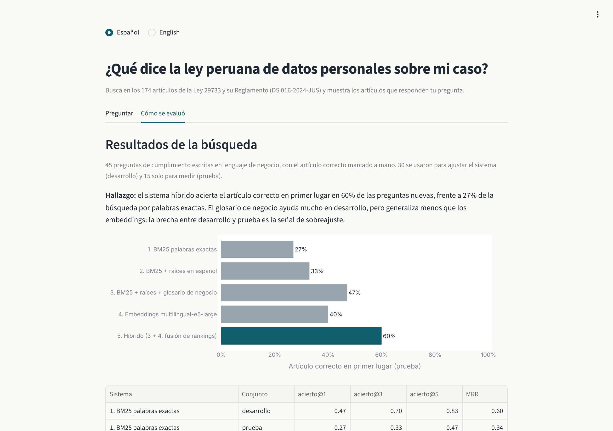

# ¿Qué dice la ley peruana de datos personales sobre mi caso?

*[English below](#english)*

Asistente de búsqueda sobre la **Ley N.º 29733 de Protección de Datos Personales** y su **Reglamento (DS 016-2024-JUS)**. Recibe una pregunta escrita como la haría un equipo de negocio ("¿en cuántas horas debo avisar si nos hackean?") y devuelve los artículos que la responden. Con una API key de Anthropic, además redacta una respuesta corta que cita cada artículo.



## La pregunta de negocio

Las áreas comerciales, de riesgos y de datos preguntan sobre cumplimiento con sus propias palabras, y la norma usa otras: "borrar" es *supresión*, "nos hackearon" es *incidente de seguridad*, "un servidor en otro país" es *flujo transfronterizo*. ¿Qué tan bien puede un buscador encontrar el artículo correcto a pesar de esa diferencia de vocabulario, y cómo saberlo con números y no por intuición?

## Resultado

Se escribieron 45 preguntas de cumplimiento en lenguaje de negocio y se marcó a mano el artículo correcto. 30 se usaron para ajustar el sistema (desarrollo) y 15 se guardaron solo para medirlo (prueba).

| Sistema | Acierto @1 (prueba) | Acierto @3 (prueba) | Acierto @5 (prueba) | MRR (prueba) | MRR (desarrollo) |
|---|---|---|---|---|---|
| 1. BM25, palabras exactas | 0.27 | 0.33 | 0.47 | 0.34 | 0.60 |
| 2. BM25 + raíces en español | 0.33 | 0.53 | 0.67 | 0.46 | 0.53 |
| 3. BM25 + raíces + glosario de negocio | 0.47 | 0.60 | 0.73 | 0.56 | 0.75 |
| 4. Embeddings `multilingual-e5-large` | 0.40 | **0.73** | **0.87** | 0.58 | 0.78 |
| **5. Híbrido (3 + 4, Reciprocal Rank Fusion)** | **0.60** | 0.67 | 0.80 | **0.67** | **0.80** |

**Hallazgos**

- El sistema híbrido pone el artículo correcto en primer lugar en el 60% de las preguntas nuevas, frente al 27% de la búsqueda por palabras exactas. Es el que usa la app.
- El glosario de negocio sube mucho el resultado en desarrollo (MRR 0.53 → 0.75) pero bastante menos en prueba (0.46 → 0.56). Se construyó mirando los fallos de desarrollo, así que esa brecha es justamente la señal de sobreajuste que el conjunto de prueba debe detectar. Un primer glosario que incluía términos de las preguntas de prueba se descartó para no inflar el resultado.
- Los embeddings generalizan mejor que el glosario: encuentran el artículo entre los primeros 5 en el 87% de las preguntas nuevas, aunque menos veces en primer lugar. Combinar ambos rankings da lo mejor de los dos.
- Con 15 preguntas de prueba, cada pregunta vale ~7 puntos porcentuales. Las diferencias pequeñas entre sistemas no son concluyentes.
- Se probó también `paraphrase-multilingual-mpnet-base-v2`; quedó por debajo de e5-large (acierto @3 en prueba 0.53).



## El ángulo de gobierno de datos

- **Glosario de negocio:** [`src/glossary.py`](src/glossary.py) enlaza términos de negocio con términos de la norma, igual que un glosario de un programa de gobierno de datos.
- **Calidad del dato de entrada:** el Diario Oficial publica a dos columnas y la extracción del PDF desordena párrafos y mezcla cabeceras de página. [`src/ingest.py`](src/ingest.py) asigna cada párrafo numerado ("18.1 …") al artículo de su número, quita cabeceras y pies, corrige ligaduras y **reporta** lo que no pudo recuperar en lugar de ocultarlo (el artículo 33 del Reglamento no tiene texto recuperable en el PDF oficial).
- **Medición antes que intuición:** cada cambio se mide con [`src/evaluate.py`](src/evaluate.py) contra preguntas etiquetadas, con un conjunto de prueba separado.
- **Trazabilidad:** cada respuesta muestra el artículo completo y su fuente oficial en gob.pe; la respuesta con IA solo puede usar esos artículos y debe citarlos.

## Cómo ejecutarlo

```bash
pip install -r requirements.txt
streamlit run app/app.py
```

- `data/articulos.jsonl` ya viene en el repositorio (174 artículos). Para regenerarlo desde los PDF oficiales: `python src/ingest.py` (requiere `pdftotext`, de poppler).
- La primera ejecución descarga el modelo `intfloat/multilingual-e5-large` (~2.2 GB) desde Hugging Face. Los embeddings de los artículos ya vienen calculados en `data/embeddings/`. En Railway conviene un servicio con al menos 3 GB de RAM.
- Respuesta redactada con IA (opcional): definir la variable de entorno `ANTHROPIC_API_KEY` en Railway. La clave nunca se guarda en el repositorio. Sin ella, la app muestra los artículos, que son la fuente verificable.
- Evaluación: `python src/evaluate.py` · Tests: `pip install -r requirements-dev.txt && pytest`

## Fuentes

- Ley N.º 29733 — [gob.pe](https://www.gob.pe/institucion/anpd/normas-legales/2018427-29733-2011)
- Reglamento, Decreto Supremo N.º 016-2024-JUS — [gob.pe](https://www.gob.pe/institucion/anpd/normas-legales/6554453-16-2024-jus)

**Herramienta educativa. No es asesoría legal.**

---

## English

**What does Peru's personal data protection law say about my case?** A search assistant over Law 29733 and its 2024 Regulation. It takes a compliance question in business language and returns the articles that answer it; with an Anthropic API key it also drafts a short answer that cites each article.

**Business question:** business teams ask about compliance in their own words ("we got hacked"), the law uses others ("security incident"). How well can retrieval bridge that gap, measured with numbers rather than intuition?

**Result:** 45 hand-labeled questions, 30 for development and 15 held out for testing. The hybrid system (BM25 with Spanish stemming and a business glossary, fused with `multilingual-e5-large` embeddings via Reciprocal Rank Fusion) ranks the correct article first for **60%** of unseen questions, vs. 27% for exact-word search (test MRR 0.67 vs. 0.34). The glossary helps a lot on development data but generalizes less than embeddings; that dev-test gap is the overfitting signal the held-out set exists to catch. With only 15 test questions, each one is worth ~7 points, so small differences are not conclusive.

**Data governance angle:** a business glossary mapped to legal terms; input-quality handling of a two-column official PDF (paragraphs reassigned by number, page headers removed, unrecoverable articles reported, not hidden); every change measured against labeled questions; every answer traceable to the full article and its official source.

**Run:** `pip install -r requirements.txt && streamlit run app/app.py`. The e5 model (~2.2 GB) downloads on first run; set `ANTHROPIC_API_KEY` as an environment variable to enable AI answers (never committed).

**Educational tool. Not legal advice.**

## Licencia / License

MIT. Ricardo Dulanto.
